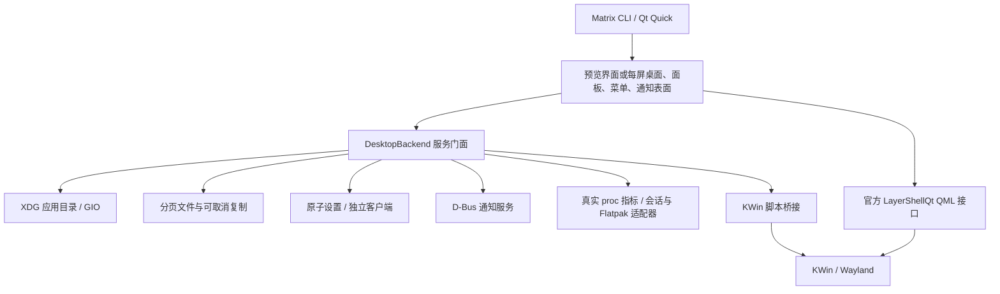

# Matrix 架构

阶段与验收 ID 以 [OMEGA 流程](omega-development-workflow.md) 和 [清单](acceptance.json) 为准。

## 运行路径

KWin 管合成、窗口管理和输入路由，DRM/KMS 与驱动由宿主提供。
Qt Quick/QML 管界面；PySide6 负责低频状态与服务协调，未实现新合成器或 DOM 桌面。

## 并发与模型

`LatestWorker` 使用一个工作线程、一个运行任务和一个最新待执行请求；以修订号丢弃过期结果，不为每次输入无限排队。
应用扫描/筛选、设置、文件、系统状态各有有界工作器。阻塞 I/O、进程等待和目录遍历不在 GUI 线程执行。
设置和笔记通过临时文件、fsync、原子替换持久化；退出时保存最后一次待写入状态。
文件每页 200 项，QML 列表虚拟化并复用，复制按块检查取消，只清理本次创建的未完成目标。

CPU 密集型索引/解码应使用独立进程或原生工作模块；Python GIL、全量 QVariant 模型转换及大目录增长仍需后续 profiler 验证。
图片使用 Qt Quick 异步解码，媒体使用 Qt Multimedia；云端无音频设备时不宣称音质或听感通过。

## 原生桌面与 KWin

`DesktopSession` 为每个 Qt 屏幕创建 `DesktopSurface` 和 `PanelSurface`，通过官方 `org.kde.layershell 1.0` 附加属性配置角色。
背景使用 Background 层和 desktop scope；面板使用 Top 层、dock scope，并保留 72 逻辑像素。
屏幕移除后释放对应表面，重连时重建；主屏变化更新通知显示目标。

菜单使用临时的透明 Overlay 层窗口，内部绘制有限大小的不透明内容；外部点击和 Esc 可关闭。
这是针对当前 Qt 6.8 / LayerShellQt 组合的菜单裁剪问题采用的实现，增加了一个瞬时的全屏透明缓冲区。
真实 GPU 带宽、功耗和尾延迟需要 PERF-01 验证；不将软件合成结果当作优化完成。
任务栏右键菜单及系统对话框在该表面内部绘制，避免被 72 像素面板窗口裁剪。

窗口状态使用 KWin 6.3 支持的脚本 API：`workspace.windowList`、窗口/焦点信号、`callDBus`。
桥接只接受当前 `org.kde.KWin` 唯一所有者发布的状态；控制请求采用固定操作表和 JSON 转义的窗口 UUID。
每次控制加载短脚本并卸载，状态监控只监听变化，不逐帧轮询。此路径的动作尾延迟尚未做实机验收。
当前桥接断开后不自动完成整套会话恢复，可信锁定与升级回滚仍属 SESSION-01 缺口。

验证组合为 KWin 6.3.6、LayerShellQt 6.3.4、系统 Qt 6.8.2 与 PySide Qt 6.8.3。
客户端先选择自身 Qt 库，隔离自身插件和 QML 模块；仅引入需要的 LayerShellQt 模块，避免系统 Qt 私有插件污染。
原生 Konsole/kscreen-doctor 使用发行版 Qt 路径；普通应用启动时不继承 Matrix 注入的 Qt 插件路径。
其他工具链版本需重新执行云端矩阵，不能推断为兼容。

官方接口核对来源：
[KWin workspace API](https://github.com/KDE/kwin/blob/v6.3.6/src/scripting/workspace_wrapper.h)、
[KWin Window API](https://github.com/KDE/kwin/blob/v6.3.6/src/window.h)、
[LayerShellQt 示例](https://github.com/KDE/layer-shell-qt/blob/v6.3.4/tests/quicktest.qml)。

## 系统功能

- 应用目录遵循 XDG 顺序与隐藏覆盖规则，过滤当前桌面可见性和 TryExec；Exec 由 GIO 处理，不拼接 shell。
- 通知在专用 asyncio 线程运行 D-Bus；Qt 信号回到 GUI。拒绝取代已有服务，支持替换、动作、关闭原因、超时与勿扰。
- 系统指标读取真实 `/proc`；进程操作验证 UID、启动时间和 pidfd，避免 PID 重用。无设备或服务时明确不可用。
- 锁定委托可信 ScreenSaver 服务并核对 GetActive，不实现接受任意 PIN 的锁屏页面。
- 软件管理调用已有用户 Flatpak，保留默认校验；当前容器无 Flatpak/可用用户命名空间，安装/卸载未验证。
- 计算器、笔记、图片和音频是独立 Qt 进程；终端使用 Konsole 的真实 PTY，不用命令分支模拟终端。

## 资源与会话

`packaging/systemd` 提供 interactive/background slice 和需要配置可执行路径的 user service 模板；均未启用。
CPUWeight、IOWeight 是相对竞争权重，MemoryLow 是尽力保护；数值需实机压力校准。
当前云环境 cgroup 不可写、systemd 用户管理器 offline，不能证明隔离或崩溃重启策略已生效。

## 自动检查

`tools/check.sh`：验收清单结构、pytest/JUnit、offscreen QML 帧提交。
`tools/cloud_check.py`：安装后的 CLI 与五组 KWin 虚拟输出场景，包含真实应用、文件关联、通知、窗口控制、混合缩放和输出重连。
GitHub 托管的临时 runner 保存报告与 wheel；不向公网 PR 提供长期特权实机 runner。
云端证据和完整发布验收的区别见 [验证报告](cloud-validation.md)；不自动合并或发布环境。
